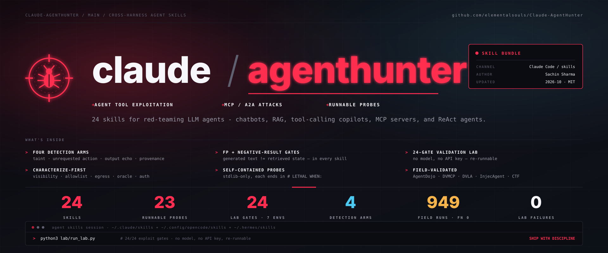

# claude-agenthunter

> **Pentest AI agents — and prove both the findings and the absences.** A skill bundle plus a runnable engine for red-teaming LLM agents: chatbots, RAG assistants, tool-calling copilots, MCP servers, and autonomous ReAct agents · **24 skills** (23 hunt + methodology) · 4 detection arms · 24/24 lab gates · 7 lab environments · FN 0 over 949 field runs · loads into Claude Code, OpenCode, Hermes, Codex CLI and AntiGravity.

Built by **[Sachin Sharma](https://www.linkedin.com/in/sachinsharma8080/)** — Bug Hunting & GenAI Security Research.

---

Sibling to [Claude-BugHunter](https://github.com/elementalsouls/Claude-BugHunter) — same shape,
different quarry. BugHunter hunts web apps; Claude-AgentHunter hunts the agents themselves.

```
24 skills   ·   4 detection arms   ·   24/24 lab gates   ·   7 lab environments   ·   FN 0 over 949 runs
```

## What is this

A drop-in skill bundle for the [Claude Code skills system](https://docs.claude.com/en/docs/claude-code/skills) (and OpenCode, Hermes, Codex CLI, AntiGravity). Install once and the harness stops guessing at agent security and starts running a disciplined pentest: it fingerprints the target agent, picks the right `hunt-agent-*` skills by surface, runs their stdlib-only probes, scores the traces with a 4-arm engine, and gates every finding so a fluent answer never ships as a leak and a silent probe never ships as "clean". Describe the target in plain English and the relevant skills auto-load — no invocation by name. The whole flow runs as one command, `/hunt-agent`, or stage by stage (see [Commands](#commands)).

## Why it exists

An agent generates text; it does not retrieve state. That creates two failure modes a web pentest
never has to worry about, and **Claude-AgentHunter is built around catching both**:

- A fluent answer looks identical to a real leak → the **False-Positive gate**.
- A silent probe looks identical to a secure target → the **Negative-Result gate**.

The second one is the hard one. Across this project's own development, **ten probe defects each
reported a compromise as clean** — a similarity gate that scored a real leak 0.03, an HTTP 500
counted as a refusal that buried a confirmed bypass, a token floor that hid the forgery that leaked
the flag. Every one looked like a passing test. Both gates live in `engine/gates.py` and ship in
every skill.

## How the skills work

Each skill is `skills/<name>/SKILL.md` — Agent-Skills markdown with frontmatter (`name`,
`description`, `sources`, `validated_against`, `report_count` — the count of in-house field-validated
reports behind the skill, 0 for reference-only). Harnesses topic-match on the description; describing
your test in plain English loads the relevant skills, no explicit invocation. Unlike static
methodology skills, each one carries a **Runnable Probe** that executes against a live agent and a
**`# LETHAL WHEN:`** line tying its output to the gate. Catalog: [`docs/skills.md`](docs/skills.md).

## The engine (what connects and merges)

`engine/` is the deterministic core. It normalises any target into one trace shape
(`engine/adapters/`), runs four complementary detection arms over it, and gates the result:

| arm | detects | blind to |
|---|---|---|
| **A · taint** | an attacker-planted value reaching a tool argument | injections that reuse data the agent already holds |
| **B · unrequested action** | a state-changing call the clean baselines never made | wording drift (needs baselines scaled to argument entropy) |
| **C · output echo** | injected content surfacing in the agent's own voice | paraphrase; quoted data (stripped) |
| **D · provenance** | the agent acting on a value only untrusted content supplied | nothing structural — the general case |

No arm is sufficient alone. Taint is 64/64 on one suite and **0/39** on another. A target is clean
only when all arms agree **and their controls fired**.

```sh
python3 engine/score.py agentdojo <runs_dir> <suite> --baselines d1,d2
```

## Commands

The pipeline runs end to end as `/hunt-agent`, or one stage at a time:

| command | stage |
|---|---|
| `/characterize-agent <target>` | fingerprint visibility · allowlist · egress · oracle · auth — before any payload |
| `/hunt-agent <target>` | full workflow: characterize → select skills → probe → score → gate |
| `/score-agent <runs_dir> <suite>` | run the 4 detection arms over captured traces + apply the gates |
| `/validate-agent` | gate one finding through the FP + Negative-Result gates |
| `/report-agent` | write the submission-ready finding, scored by the sink it reached |

## Install

```sh
git clone https://github.com/elementalsouls/Claude-AgentHunter && cd Claude-AgentHunter
./scripts/install.sh --all          # detects Claude Code, OpenCode, Hermes, Codex, AntiGravity
./scripts/install.sh --claude       # or one harness
```
Or as a Claude Code plugin — namespaced, no copy, updates on version bump:
```sh
/plugin marketplace add elementalsouls/Claude-AgentHunter
/plugin install claude-agenthunter@elementalsouls
```

## Proof it works — `lab/` and `field/`

- **`lab/`** — 24 deterministic exploit gates (`python3 lab/run_lab.py`), no model, no API key. Each
  encodes a vulnerability class and its control; `[CONFIRMED]` means re-runnable, not "the model said so".
- **`field/`** — evidence from live/benchmark targets: AgentDojo (4 suites, 949 runs, FN 0), DVMCP
  (10/10), DVLA (ReAct forgery → SQL chain), InjecAgent (arm D 7/7 indirect), a real MCP target, ARKX.

## Documentation

- [`USAGE.md`](USAGE.md) — the workflow, the engine, the lab, field evidence, end to end.
- [`INSTALL.md`](INSTALL.md) — plugin + copy install across five harnesses.
- [`docs/skills.md`](docs/skills.md) — the 23-skill catalog.
- [`docs/THREAT-MODEL.md`](docs/THREAT-MODEL.md) · [`docs/COVERAGE-MATRIX.md`](docs/COVERAGE-MATRIX.md) · [`docs/RESEARCH-2026.md`](docs/RESEARCH-2026.md) · [`docs/DEFENSES-AND-DETECTION.md`](docs/DEFENSES-AND-DETECTION.md) · [`docs/REFERENCES.md`](docs/REFERENCES.md)
- [`CONTRIBUTING.md`](CONTRIBUTING.md) · [`CHANGELOG.md`](CHANGELOG.md)

## Authorized use only

For testing agents you own or are explicitly authorized to assess. The probes send live payloads
and the lab targets are intentionally vulnerable. See [`SECURITY.md`](SECURITY.md).
